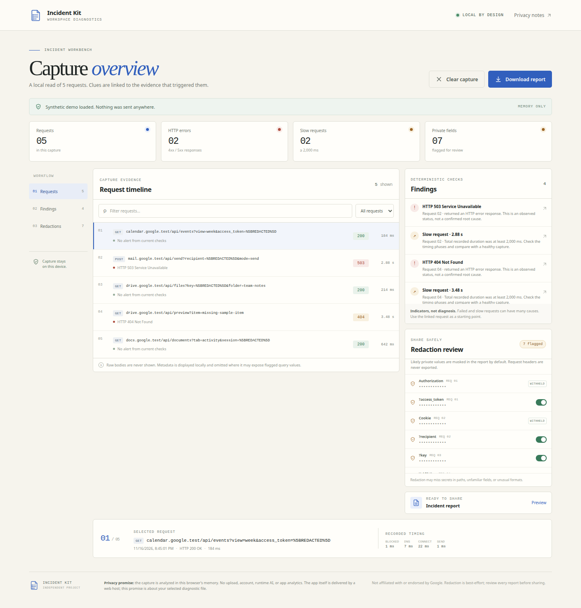

# Workspace Incident Kit

> **Your HAR is evidence—not something you should have to upload.**
>
> Inspect a browser capture, follow the evidence, and export a safer incident report. The selected file is analyzed in your browser; the app has no upload backend.



[Desktop demo](docs/workbench-preview.png) · [Mobile demo](docs/mobile-preview.png)

## The problem

A browser capture can be the fastest way to understand a support issue—and a risky thing to share. HAR files may contain cookies, credentials, URLs, and submitted data. Google’s own [HAR Analyzer](https://toolbox.googleapps.com/apps/har_analyzer/) warns about these risks. Workspace admins and support engineers still have to piece together request failures, timings, and safe-to-share evidence by hand.

**Incident Kit makes that handoff less painful:** load a local capture, inspect what happened, review likely redactions, and export a concise report tied to the underlying requests.

## Try it without a real capture

Open the app and choose **Try the synthetic sample**. The bundled capture uses fake values and reserved `.test` domains. Nothing from your account is needed.

A demo link can preload the sample with `?demo=1` once the app is hosted.

## What works today

- Import a local `.har` file up to 15 MB, or use the bundled synthetic example.
- Search and filter the request timeline by visible request metadata, HTTP errors, and slow requests.
- Flag HTTP 4xx/5xx responses and requests that took at least 2,000 ms. Each finding opens its supporting request.
- Detect common secret-bearing header names and likely sensitive query values. Query values appear redacted by default; turning off a detected redaction requires confirmation.
- Preview, copy, or download a Markdown report with sanitized request evidence.
- Keep the selected capture in browser memory. The app has no account, OAuth, API key, server-side upload, analytics, telemetry, runtime AI, or raw-capture persistence.

Request headers and request/response bodies are never included in the Markdown report. Analysis runs in a short-lived Web Worker, and the app does not save raw captures in local storage or IndexedDB.

## Privacy: precise, not magical

The current app code does not send selected HAR contents or report data to a server. Platform-injected analytics and the Manus badge are disabled for this project. The web host serves the static application; normal hosting/CDN request logs may still apply, but the selected capture is not transmitted by the app. See [PRIVACY.md](PRIVACY.md) for the data-flow details.

Redaction is **best-effort**. It can miss secrets in URL paths, unfamiliar parameter names, unusual encodings, or formats the detector does not recognize. Review every exported report before sharing. “No likely secrets found” does not mean “safe to share.” Findings are indicators, not proof of root cause.

## Run locally

Requires Node.js 22+ and pnpm 10.18.0.

```bash
corepack enable
pnpm install
pnpm dev
```

Run the project checks:

```bash
pnpm check
pnpm test
pnpm build
```

No credentials or cloud services are needed to run the MVP.

## Product boundaries

The current release handles HAR request metadata only. It does not inspect request or response bodies, parse Google Workspace product logs, check DNS, access a Workspace tenant, or prove why a request failed. Email-header analysis and public DNS checks are roadmap items, not current features.

## Contributing

Useful early contributions include synthetic HAR edge cases, tested redaction rules, accessible UI improvements, and clear evidence-based explanations. Read [CONTRIBUTING.md](CONTRIBUTING.md) first. Never submit real captures, cookies, credentials, customer data, or production hostnames. Use synthetic `.test` data only.

For a suspected vulnerability, follow [SECURITY.md](SECURITY.md) and do not post sensitive artifacts publicly.

## Project status

Early MVP. The interface and feature set will evolve as the privacy contract and tests get stronger. This independent project is not affiliated with, endorsed by, or supported by Google. “Google Workspace” is used only to describe the troubleshooting context.

## License

This project is licensed under the [MIT License](LICENSE).
